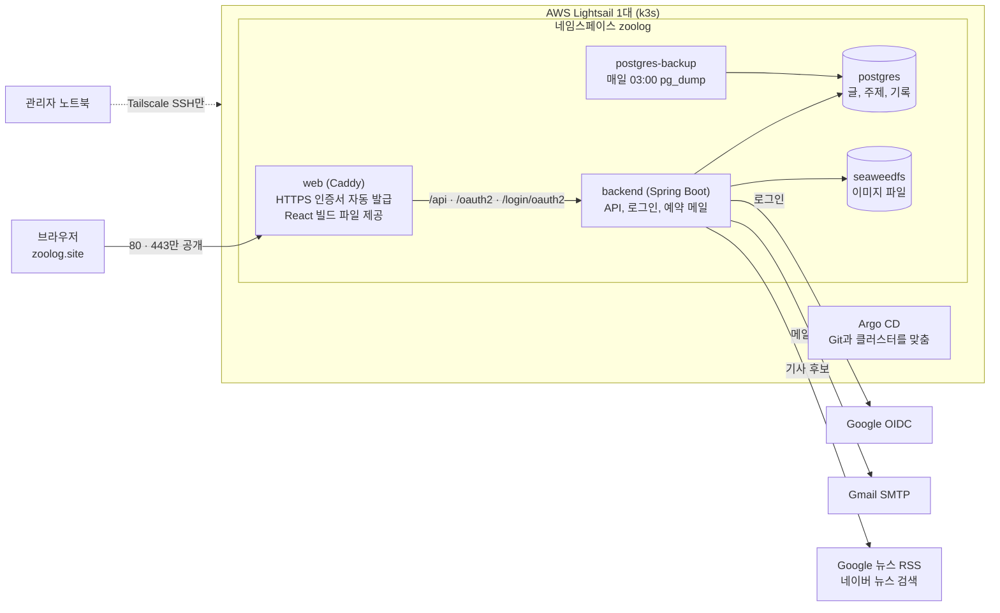
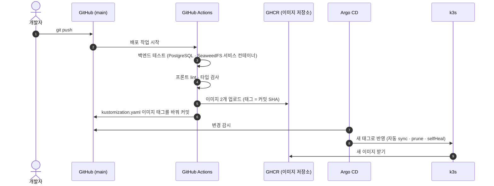
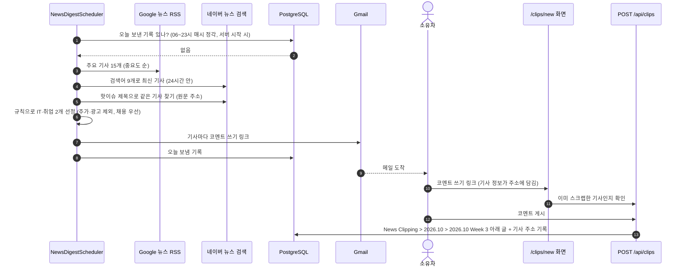
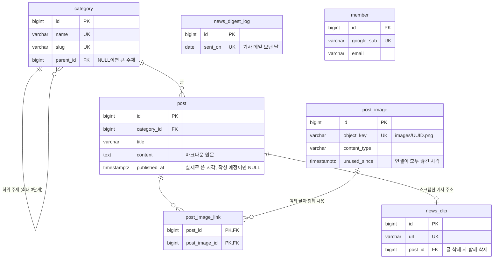

# Zoolog

> 공부한 내용을 별자리 그래프로 쌓아 가는 개인 개발 블로그

공부 글을 주제 3단계(예: Cloud Engineer > AWS-SAA > 컴퓨팅)로 정리해 홈 화면의 그래프에 별자리처럼 보여 주고, 글을 쓴 날을 주제별 달력에 색으로 쌓아 가는 1인 개발 서비스. 글쓰기는 소유자만, 방문자는 읽기만 가능.

| 구분 | 내용 |
| --- | --- |
| 주소 | https://zoolog.site |
| 기간 | 2026.10 ~ (진행 중) |
| 형태 | 개인 프로젝트 (기획 · 디자인 · 백엔드 · 프론트엔드 · 인프라 전부) |
| 운영 | AWS Lightsail 1대 + k3s + Argo CD (GitOps) |

## 목차

- [주요 기능](#주요-기능)
- [기술 스택](#기술-스택)
- [시스템 구성](#시스템-구성)
- [배포 흐름 (GitOps)](#배포-흐름-gitops)
- [아침 기사 메일과 뉴스 스크랩](#아침-기사-메일과-뉴스-스크랩)
- [데이터 모델](#데이터-모델)
- [기술적 결정과 트러블슈팅](#기술적-결정과-트러블슈팅)
- [학습 노트](#학습-노트)
- [실행 방법 (개발)](#실행-방법-개발)

## 주요 기능

- **그래프 홈:** 주제와 글을 별자리 지도로 표시. 힘 기반 배치(force-directed)로 수백 개 글도 겹치지 않게 퍼짐, 주제를 누르면 그 별자리로 1초 확대, 주소(`/?focus=slug`)로 확대 상태 공유
- **공부 글:** 마크다운 원문 저장, 편집기에서 이미지 끌어놓기·붙여넣기 업로드, 주제 3단계 분류
- **Streak:** 큰 주제마다 한 달 달력에 글 쓴 날을 하위 주제 색으로 칠함, 칸을 가리키면 그날 글, 누르면 글 화면으로 이어서 이동
- **소유자 로그인:** Google OIDC, 지정한 이메일 1개만 로그인 허용, 서버 세션 + CSRF 보호
- **소유자 메일:** 매일 07:00·18:00 공부 알림, 06:00 아침 기사(핫이슈 1 + IT·취업 2, Google 뉴스 RSS · 네이버 뉴스 검색 API, 규칙 기반 선정)
- **뉴스 스크랩:** 아침 기사 메일의 링크로 글을 쓰면 News Clipping > 달 > 주 주제 아래 게시(기사 본문은 복제하지 않고 제목·원문 링크·직접 쓴 글만)
- **첫 진입 프리로더:** 로고 `Z`가 차오른 뒤 머리글 자리로 이동하고 격자선이 그어지는 애니메이션

## 기술 스택

| 영역 | 기술 |
| --- | --- |
| 백엔드 | Java 25, Spring Boot 4.1, Spring Security(OAuth2 Login), Spring Data JPA, Hibernate 7, Flyway |
| DB · 저장소 | PostgreSQL 18, SeaweedFS(S3 호환, AWS SDK for Java v2) |
| 프론트엔드 | React 19, TypeScript 6, React Router 8(SPA 모드), Vite 8, react-markdown |
| 인프라 | AWS Lightsail, k3s, Argo CD(core), Kustomize, Caddy(자동 HTTPS), Tailscale |
| CI/CD | GitHub Actions, GHCR(GitHub Container Registry) |
| 개발 환경 | VS Code Dev Containers(Docker Compose: 앱 · PostgreSQL · SeaweedFS) |

## 시스템 구성

서버는 Lightsail 1대이고, 그 위의 k3s(가벼운 쿠버네티스)에서 컨테이너 4종이 돔. 인터넷에 열린 것은 Caddy의 80·443 포트 하나뿐이고 DB와 이미지 저장소는 클러스터 안에서만 접근 가능.



| 구성 요소 | 종류 | 메모리 상한 | 배포 방식 |
| --- | --- | --- | --- |
| web (Caddy) | Deployment | 128Mi | RollingUpdate (무중단) |
| backend (Spring Boot) | Deployment | 640Mi | Recreate (약 30초 API 중단) |
| postgres | StatefulSet + PVC | 256Mi | - |
| seaweedfs | StatefulSet + PVC | 256Mi | - |
| postgres-backup | CronJob | - | 매일 03:00, 14일 보관 |

## 배포 흐름 (GitOps)

사람은 서버에 명령을 치지 않고 `main`에 push만 함. 서버에 무엇이 떠 있어야 하는지는 Git의 `deploy/k8s/`가 정하고, Argo CD가 Git과 클러스터를 계속 비교해 다르면 맞춤.



- 되돌리기는 태그 커밋을 `git revert`. Git과 서버가 항상 같은 상태를 가리킴
- 화면 서버(Caddy)는 RollingUpdate 무중단 배포: 배포 중 1초 간격 측정에서 화면 응답 실패 0회
- 백엔드는 2GB 메모리 한계로 Recreate(약 30초 API 중단). 무중단 전환은 보류([학습 노트](docs/learn/01-zero-downtime.md))
- 서버 준비 절차: [deploy/README.md](deploy/README.md)

## 아침 기사 메일과 뉴스 스크랩

매일 06:00 소유자에게 기사 3개(핫이슈 1, IT·취업 2)를 메일로 보내고, 메일 속 링크로 글을 쓰면 블로그 글이 됨. 서버가 그 시각에 꺼져 있었거나 발송이 실패하면 그날 안에 다시 보냄.



- 공개 글에는 기사 제목·원문 링크·코멘트만 (기사 본문 복제 안 함)
- 같은 기사(주소)는 한 번만 스크랩. 글을 지우면 다시 가능
- 공부 알림 메일(07:00 AWS-SAA, 18:00 영어)은 설정 파일 목록대로 발송

## 데이터 모델

스키마는 Flyway(V1~V9)가 관리하고, JPA는 `ddl-auto: validate`로 엔티티와 DB가 맞는지 검사만 함.



- 이미지는 글을 저장하기 전에 먼저 올라가고, 글을 저장할 때 본문에 쓰인 이미지만 연결. 연결이 모두 끊긴 지 1일이 지나면 매일 04:00 정리 작업이 파일과 기록을 삭제
- 모든 시각은 `TIMESTAMPTZ`, 기준 시간대는 Asia/Seoul

## 기술적 결정과 트러블슈팅

- [기술적 결정 기록](docs/portfolio/decisions.md): 무엇을 왜 골랐는지 (선택지, 이유, 결과)
- [트러블슈팅 기록](docs/portfolio/troubleshooting.md): 문제 → 원인 → 해결 → 배운 점
- [kubectl 자주 쓰는 명령](docs/kubectl-cheatsheet.md)

## 학습 노트

만들면서 생긴 질문을 하나씩 풀어 쓴 글. 질문 → 답 → 그림 → 직접 확인하는 방법 순서: [docs/learn](docs/learn/README.md)

## 실행 방법 (개발)

VS Code에서 저장소를 열고 **Reopen in Container**. `.devcontainer/.env.example`을 `.env`로 복사해 값 채움.

```bash
cd backend && ./gradlew bootRun      # http://localhost:8080
cd frontend && npm run dev           # http://localhost:5173
cd backend && ./gradlew test         # 개발 DB에서 실행 후 롤백
```
