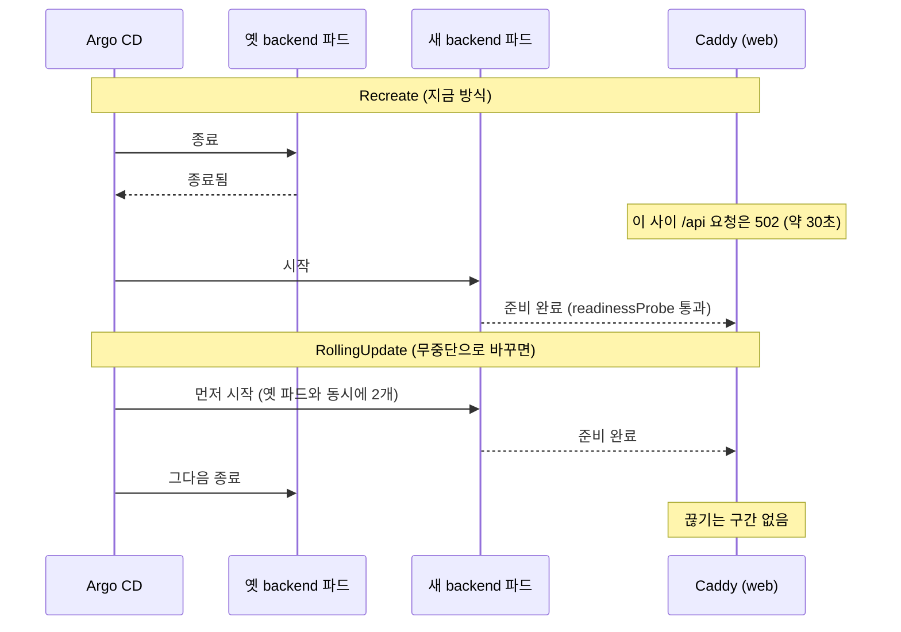
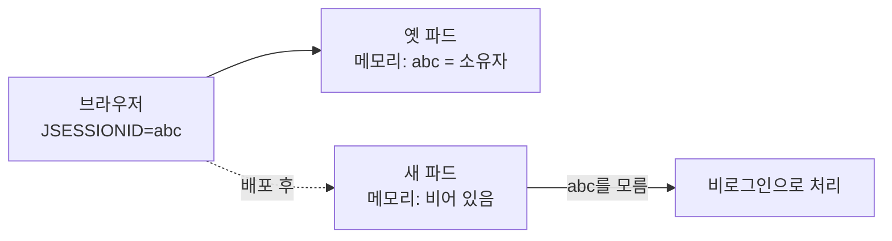

# 01. 백엔드도 무중단 배포를 해야 할까

배포할 때마다 API가 30초쯤 끊긴다는 이야기를 하자 이런 질문이 나왔습니다.

> 무중단 배포 여부는 너가 보기엔 어떨 것 같아

## 답부터

지금은 하지 않는 편이 낫습니다. 그래서 보류했습니다.

끊기는 시간이 짧고 방문자가 적은 데 비해, 무중단으로 바꾸면 2GB 서버에서 메모리를 640Mi 더 써야 하기 때문입니다. 게다가 무중단으로 바꿔도 소유자가 배포 때마다 다시 로그인해야 하는 문제는 그대로 남습니다.

왜 그런지는 배포 방식 두 가지를 비교하면 보입니다.

---

## 배포 방식은 두 가지입니다

쿠버네티스 Deployment는 새 버전으로 바꿀 때 `strategy`에 적힌 방식을 따릅니다.

| 방식 | 순서 | 이 프로젝트에서 쓰는 곳 |
| --- | --- | --- |
| `Recreate` | 옛 파드를 모두 내린 뒤 새 파드를 띄웁니다 | backend (Spring Boot) |
| `RollingUpdate` | 새 파드를 먼저 띄우고, 준비되면 옛 파드를 내립니다 | web (Caddy) |

쿠버네티스 문서는 Recreate를 이렇게 설명합니다.

> All existing Pods are killed before new ones are created when `.spec.strategy.type==Recreate`.
> (`.spec.strategy.type==Recreate`이면 새 파드를 만들기 전에 기존 파드를 모두 종료합니다.)

`deploy/k8s/backend.yaml`에 실제로 이렇게 적혀 있습니다.

```yaml
spec:
  strategy:
    type: Recreate
```

## 시간 순서로 보면 이렇습니다



차이는 한 줄로 정리됩니다. **Recreate는 비는 시간이 생기고, RollingUpdate는 겹치는 시간이 생깁니다.**

화면 서버(Caddy)는 RollingUpdate로 바꾼 뒤 배포 중 1초 간격으로 요청해 실패가 0번인 것을 확인했습니다([결정 기록 #4](../portfolio/decisions.md)). 그런데 백엔드는 그렇게 하지 않았습니다.

## 겹치는 시간에 메모리가 두 배가 됩니다

RollingUpdate는 옛 파드와 새 파드가 잠깐 함께 떠 있습니다. 메모리도 그동안 둘 몫이 필요합니다.

| 구성 요소 | 메모리 상한 |
| --- | --- |
| backend | 640Mi |
| postgres | 256Mi |
| seaweedfs | 256Mi |
| web | 128Mi |
| 합계 | 1,280Mi |

서버 메모리는 2GB이고 그 안에서 k3s와 Argo CD도 돕니다. 배포 순간에 backend가 하나 더 뜨면 상한 기준으로 640Mi가 더 붙습니다. 스왑(디스크를 메모리처럼 쓰는 공간) 2GB가 있어서 바로 죽지는 않겠지만, 스왑을 쓰기 시작하면 느려집니다.

Spring Boot는 켜질 때 메모리를 가장 많이 씁니다. 하필 새 파드가 켜지는 순간이 옛 파드와 겹치는 순간입니다.

## 무중단으로 바꿔도 다시 로그인해야 합니다

이게 보류한 더 큰 이유입니다.

로그인 상태(세션)는 지금 백엔드 파드의 메모리에 있습니다. 브라우저는 `JSESSIONID` 쿠키만 들고 있고, 그 번호가 누구인지는 파드만 압니다.



RollingUpdate로 바꿔도 새 파드의 메모리는 비어 있습니다. 끊기는 30초는 없어지지만, 배포 뒤 다시 로그인해야 하는 것은 같습니다.

이걸 없애려면 세션을 파드 밖에 둬야 합니다. Spring Session JDBC를 쓰면 세션이 PostgreSQL 테이블에 저장되어 어느 파드든 같은 세션을 읽습니다. 다만 테이블과 설정이 늘어나는 별도 작업입니다.

## 그래서 이렇게 정했습니다

| 무엇을 얻나 | 무엇을 내나 |
| --- | --- |
| 배포 중 API 30초 끊김이 없어짐 | 배포 순간 메모리 640Mi 추가, 스왑 위험 |
| (세션까지 하면) 배포 후 재로그인 없음 | Spring Session 테이블과 설정 추가 |

끊기는 30초는 방문자가 드문 개인 블로그에서 거의 보이지 않습니다. 화면은 이미 무중단이라 글 읽기는 계속 됩니다. 끊기는 것은 API(글 목록 새로 불러오기, 글쓰기)뿐입니다.

그래서 **메모리 사용량을 실제로 재 본 뒤 다시 판단하기로 하고 보류**했습니다.

## 직접 확인해 보시기 바랍니다

서버에서 지금 메모리를 얼마나 쓰는지 봅니다. k3s에는 사용량을 재는 metrics-server가 기본으로 들어 있습니다.

```bash
kubectl top pods -n zoolog
kubectl top nodes
free -m
```

`kubectl top pods`의 MEMORY 열이 상한(640Mi 등)보다 얼마나 낮은지가 판단 기준입니다. 여유가 크면 RollingUpdate를 다시 검토할 수 있습니다.

배포 방식이 실제로 무엇으로 들어가 있는지도 확인할 수 있습니다.

```bash
kubectl -n zoolog get deploy backend -o jsonpath='{.spec.strategy}{"\n"}'
kubectl -n zoolog get deploy web -o jsonpath='{.spec.strategy}{"\n"}'
```

배포할 때 비는 시간을 눈으로 보려면 새 터미널에서 지켜보면 됩니다.

```bash
kubectl -n zoolog get pods -l app=backend -w
```

옛 파드가 `Terminating`으로 사라진 뒤에야 새 파드가 생기는 것이 Recreate입니다. web은 새 파드가 먼저 생깁니다.

## 출처

- [Deployment 전략 (Kubernetes 문서)](https://kubernetes.io/docs/concepts/workloads/controllers/deployment/#strategy)
- [kubectl top (Kubernetes 문서)](https://kubernetes.io/docs/reference/kubectl/generated/kubectl_top/)
- [Spring Session JDBC](https://docs.spring.io/spring-session/reference/)

## 관련

- 배포 전체 흐름: [README의 배포 흐름](../../README.md#배포-흐름-gitops)
- 서버 명령: [kubectl 자주 쓰는 명령](../kubectl-cheatsheet.md)
