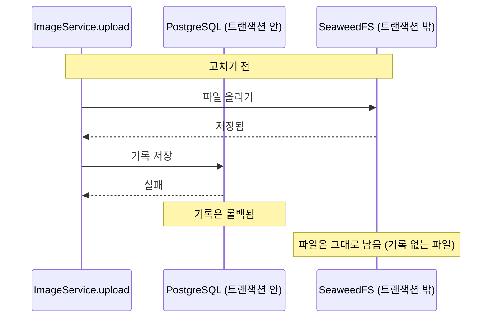
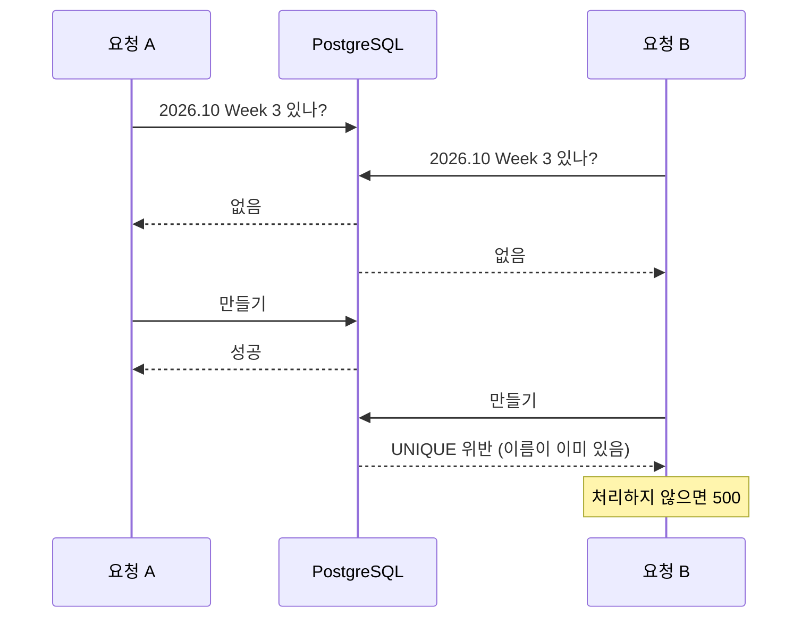
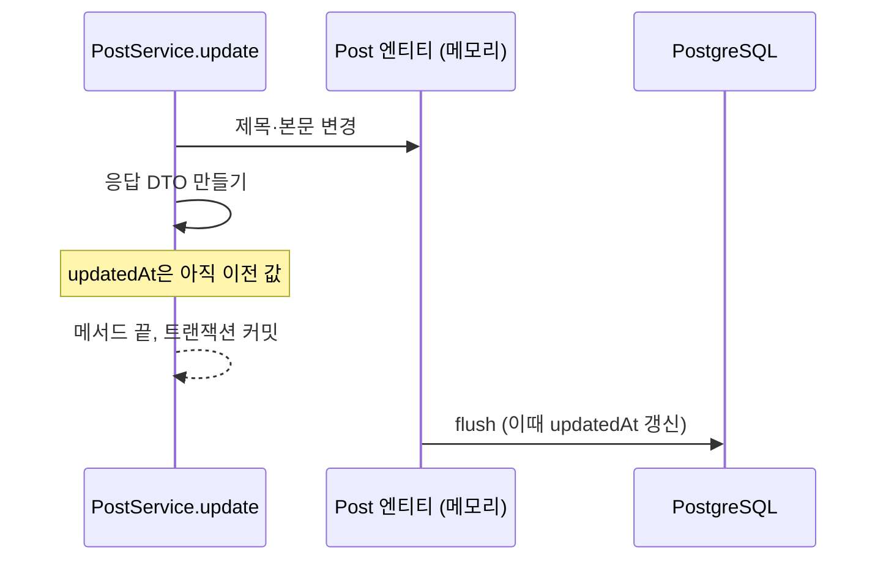

# 02. 트랜잭션을 어떻게 하자는 거지?

리팩토링 중에 "작은 위험 세 가지"를 보고했더니 이런 질문이 나왔습니다.

> 4는 트랜잭션 관련인가?

> 트랜잭션 어떻게 하자는 거지?

## 답부터

셋 다 트랜잭션의 **경계** 문제였습니다. 트랜잭션이 지켜 주는 범위 밖에서 일이 일어나거나, 범위 안이라도 생각한 시점에 일이 일어나지 않는 경우입니다.

| 문제 | 경계의 어느 쪽인가 | 고친 방법 |
| --- | --- | --- |
| 이미지 업로드가 실패하면 파일만 남음 | DB 밖의 작업 | 롤백되면 올린 파일을 지우는 후처리 등록 |
| 스크랩 두 개를 동시에 게시하면 500 | 두 트랜잭션이 동시에 | UNIQUE 위반을 잡아 409로 응답 |
| 수정 응답의 `updatedAt`이 이전 값 | 트랜잭션 안의 시점 | 응답을 만들기 전에 `flush()` |

하나씩 보겠습니다. 그 전에 트랜잭션이 무엇을 약속하는지부터 짚습니다.

---

## 트랜잭션이 약속하는 것

트랜잭션은 여러 DB 작업을 하나로 묶어서 **전부 반영되거나 전부 취소되게** 합니다. 중간에 예외가 나면 그때까지 한 DB 작업을 모두 되돌립니다(롤백).

Spring에서는 서비스 메서드에 `@Transactional`을 붙이면 그 메서드가 트랜잭션 하나가 됩니다. 이 프로젝트의 규칙은 클래스에 `@Transactional(readOnly = true)`, 쓰기 메서드에만 `@Transactional`입니다.

여기서 중요한 단어가 **DB 작업**입니다. 트랜잭션이 되돌릴 수 있는 것은 DB에 한 일뿐입니다.

## 1. DB 밖의 작업은 되돌아가지 않습니다

이미지를 올리면 두 군데에 씁니다. 파일은 SeaweedFS(S3 저장소)에, 기록은 PostgreSQL에 씁니다.



DB 기록은 롤백되지만 저장소에 올린 파일은 트랜잭션이 모릅니다. 기록이 없으니 매일 04:00 정리 작업도 그 파일을 찾지 못합니다. 아무도 모르는 파일이 영원히 남습니다.

### 고친 방법

Spring에는 트랜잭션이 끝난 뒤에 실행할 일을 등록하는 기능이 있습니다. `TransactionSynchronization`입니다. 끝나는 방식(커밋인지 롤백인지)을 알려 주므로, 롤백일 때만 파일을 지우게 할 수 있습니다.

`backend/src/main/java/com/zoolog/image/ImageService.java`의 `upload`입니다.

```java
postImageRepository.save(new PostImage(key, type.contentType, clock.instant()));
TransactionSynchronizationManager.registerSynchronization(new TransactionSynchronization() {
    @Override
    public void afterCompletion(int status) {
        if (status == STATUS_ROLLED_BACK) {
            storage.delete(key);
        }
    }
});
storage.put(key, type.contentType, bytes);
```

이제 순서가 어떻게 되든 결과가 맞습니다.

| 어디서 실패했나 | 결과 |
| --- | --- |
| 파일 올리기 | 예외 → 롤백 → 기록 취소, 후처리가 파일 삭제 시도(없는 파일이라 그냥 지나감) |
| 커밋 | 롤백 → 후처리가 올린 파일 삭제 |
| 실패 없음 | 커밋 → 후처리는 아무것도 안 함 |

## 2. 두 트랜잭션이 동시에 같은 것을 만들면

뉴스 스크랩은 게시할 때 주제(News Clipping > 2026.10 > 2026.10 Week 3)가 없으면 만듭니다. "찾아보고 없으면 만든다"는 순서입니다.

두 요청이 거의 동시에 오면 이렇게 됩니다.



두 트랜잭션은 서로의 아직 커밋되지 않은 작업을 보지 못합니다. 그래서 둘 다 "없음"을 보고 둘 다 만들려고 합니다. 한쪽은 DB의 UNIQUE 제약에 걸립니다.

DB가 막아 준 덕분에 주제가 두 개 생기지는 않습니다. 데이터는 안전합니다. 문제는 사용자가 받는 응답이 "서버 오류(500)"라는 점입니다.

### 고친 방법

UNIQUE 위반은 Spring Data가 `DataIntegrityViolationException`으로 바꿔서 던집니다. 그걸 잡아서 409(충돌)로 응답합니다.

```java
try {
    return categoryRepository.save(new Category(name, slug, parent));
} catch (DataIntegrityViolationException e) {
    throw new ResponseStatusException(HttpStatus.CONFLICT, "잠시 후 다시 시도해 주세요");
}
```

같은 기사를 동시에 두 번 게시할 때도 같은 방식으로 "이미 스크랩한 기사예요"(409)를 돌려줍니다.

여기서 하나 짚을 것이 있습니다. 미리 막는 코드("있나?" 확인)만으로는 동시 요청을 못 막습니다. **마지막 방어선은 DB 제약**이고, 코드는 그 결과를 사람이 읽을 수 있는 응답으로 바꿔 줄 뿐입니다.

## 3. 트랜잭션 안에서도 시점이 있습니다

글을 수정하면 응답에 `updatedAt`(수정 시각)이 들어갑니다. 그런데 이전 수정 시각이 담겨 왔습니다.

`updatedAt`은 JPA Auditing이 채웁니다. 그런데 채우는 시점이 "값을 바꾼 순간"이 아니라 **DB에 반영(flush)하는 순간**입니다.



JPA는 바뀐 엔티티를 바로 DB에 쓰지 않고 모아 뒀다가 커밋 직전에 한꺼번에 씁니다. 응답은 그보다 먼저 만들어졌으니 이전 값이 담깁니다.

### 고친 방법

응답을 만들기 전에 직접 반영합니다.

```java
post.update(getCategory(request.categoryId()), request.title(), request.content());
imageService.syncImages(post);
postRepository.flush();
return PostDetailResponse.from(post);
```

### 고치고 보니 이미 맞게 나오고 있었습니다

이 수정을 검증하려고 테스트를 만들었는데, `flush()`를 지워도 테스트가 통과했습니다. 원인을 찾아보니 바로 위 줄 `syncImages`가 범인이었습니다.

Hibernate는 쿼리를 실행하기 전에, 그 쿼리가 읽는 테이블에 아직 반영하지 않은 변경이 있으면 먼저 반영합니다(auto flush). 이미지를 여러 글이 함께 쓰도록 바꾸면서([04](04-shared-images.md)) `syncImages`의 조회 쿼리가 `post` 테이블을 함께 읽게 됐습니다. 그래서 그 쿼리 직전에 글 변경이 저절로 반영되고 있었던 것입니다.

| `syncImages`의 쿼리 | `post` 테이블을 읽나 | 응답의 `updatedAt` |
| --- | --- | --- |
| 바꾸기 전: `post_image`만 조회 | 아니요 | 이전 값 (버그) |
| 바꾼 뒤: `post_image_link`와 `post`를 join | 예 → auto flush | 새 값 (우연히 맞음) |

그래도 `flush()`는 남겨 뒀습니다. 다른 쿼리를 바꾸는 순간 조용히 다시 틀어지는 코드는 맞는 코드라고 하기 어렵기 때문입니다.

이 경험에서 얻은 것이 하나 더 있습니다. **고친 뒤에는 고치기 전 코드로 테스트가 실패하는지도 확인해야 합니다.** 통과만 보고 넘어갔다면 이 테스트가 아무것도 검증하지 못한다는 것을 몰랐을 것입니다.

## 정리

| 경계 | 기억할 것 |
| --- | --- |
| DB 밖 | 트랜잭션은 DB만 되돌린다. 파일, 메일, 외부 API는 따로 처리해야 한다 |
| 동시에 | 미리 확인하는 코드는 동시 요청을 못 막는다. 마지막 방어선은 DB 제약이다 |
| 시점 | JPA는 커밋 직전에 반영한다. 반영 후에 정해지는 값은 flush 뒤에 읽는다 |

## 직접 확인해 보시기 바랍니다

롤백 후처리를 검증하는 테스트입니다. 테스트 트랜잭션 없이 실제 롤백을 일으킵니다.

```bash
cd backend
./gradlew test --tests com.zoolog.image.ImageUploadRollbackTest
```

`ImageService`에서 `storage.delete(key);` 줄을 주석 처리하고 다시 돌려 보시기 바랍니다. 실패해야 정상입니다. 실패하는 것을 봐야 이 테스트가 정말 그 줄을 검증한다는 것을 압니다.

auto flush도 직접 볼 수 있습니다. SQL 로그를 켜고 글을 수정하면, `update post` 문이 메서드 끝이 아니라 이미지 조회 쿼리 바로 앞에 찍힙니다.

```bash
./gradlew bootRun --args='--logging.level.org.hibernate.SQL=debug'
```

## 출처

- [Transaction-bound Events와 TransactionSynchronization (Spring 문서)](https://docs.spring.io/spring-framework/reference/data-access/transaction/event.html)
- [TransactionSynchronization API](https://docs.spring.io/spring-framework/docs/current/javadoc-api/org/springframework/transaction/support/TransactionSynchronization.html)
- [Flushing (Hibernate 사용자 가이드)](https://docs.hibernate.org/orm/7.0/userguide/html_single/#flushing)
- [JPA Auditing (Spring Data JPA 문서)](https://docs.spring.io/spring-data/jpa/reference/auditing.html)

## 관련

- 이미지를 여러 글이 함께 쓰게 된 이유: [04](04-shared-images.md)
