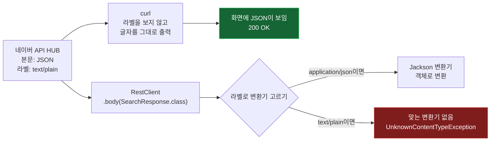

# 03. curl은 200인데 왜 앱은 못 읽나

아침 기사 메일이 처음 운영에서 나간 날, IT·취업 칸에 이렇게 찍혀 왔습니다.

> IT 취업에서는 오늘은 기사를 가져오지 못했어요라고 메일 왔네

이상한 일이었습니다. 배포 전에 서버에서 curl로 같은 네이버 API를 불러 봤고, HTTP 200과 기사 제목까지 확인했기 때문입니다.

## 답부터

네이버 API HUB가 JSON 본문을 `Content-Type: text/plain`이라고 표시해서 보냈습니다.

curl은 받은 글자를 그대로 화면에 찍기만 하니 표시가 무엇이든 상관없었습니다. Spring의 RestClient는 이 표시를 보고 "JSON으로 읽을지" 정하는데, `text/plain`이라고 하니 JSON으로 읽을 방법을 찾지 못했습니다.

같은 응답인데 받는 쪽이 무엇을 보느냐가 달랐습니다.

---

## 로그가 정확히 말해 주고 있었습니다

서버 로그에 남은 줄입니다.

```
ERROR ... NewsDigestService : IT·취업 후보를 가져오지 못함

org.springframework.web.client.UnknownContentTypeException: Could not extract response:
no suitable HttpMessageConverter found for response type [class com.zoolog.news.NaverNewsClient$SearchResponse]
and content type [text/plain;charset=UTF-8]
```

끊어 읽으면 이렇습니다.

| 로그 조각 | 뜻 |
| --- | --- |
| `no suitable HttpMessageConverter found` | 알맞은 변환기를 못 찾았다 |
| `for response type [... SearchResponse]` | `SearchResponse` 객체로 바꾸려고 했는데 |
| `and content type [text/plain;charset=UTF-8]` | 응답이 `text/plain`이라고 적혀 있어서 |

원인과 조건이 전부 한 줄에 들어 있습니다. 이 로그를 받기 전까지는 키가 없는지, 네이버가 오류를 냈는지, 시간 초과인지 추측만 할 수 있었습니다.

## Content-Type은 내용물이 아니라 라벨입니다

HTTP 응답은 머리(헤더)와 몸(본문)으로 나뉩니다. `Content-Type`은 머리에 붙는 라벨로, "몸에 든 것이 이런 형식입니다"라고 알려 줍니다.

| Content-Type | 뜻 |
| --- | --- |
| `application/json` | JSON입니다 |
| `text/plain` | 그냥 글자입니다 |
| `application/xml` | XML입니다 |

라벨과 내용물은 따로 정해집니다. 서버가 JSON을 담고 `text/plain` 라벨을 붙여 보내도 HTTP는 막지 않습니다. 이번 경우가 그랬습니다.

## 받는 쪽마다 라벨을 보는 정도가 다릅니다



RestClient는 `.body(SearchResponse.class)`를 받으면 등록된 변환기(HttpMessageConverter)들에게 차례로 묻습니다. "이 라벨의 응답을 이 타입으로 바꿀 수 있나?" JSON 변환기(Jackson)는 `application/json` 계열만 맡겠다고 답합니다. 그래서 `text/plain`은 아무도 맡지 않았습니다.

## 고친 방법

라벨을 믿지 않고 직접 읽었습니다. 본문을 글자(`String`)로 받으면 글자 변환기가 맡으므로 라벨과 상관없이 받아집니다. 그다음 JSON 해석은 직접 합니다.

`backend/src/main/java/com/zoolog/news/NaverNewsClient.java`입니다.

```java
String body = restClient.get().uri(uri)
        .header("X-NCP-APIGW-API-KEY-ID", clientId)
        .header("X-NCP-APIGW-API-KEY", clientSecret)
        .retrieve()
        .body(String.class);
return parse(body, jsonMapper);
```

```java
static List<SearchResponse.Item> parse(String body, JsonMapper jsonMapper) {
    if (body == null || body.isBlank()) {
        return List.of();
    }
    SearchResponse response = jsonMapper.readValue(body, SearchResponse.class);
    return response.items() == null ? List.of() : response.items();
}
```

`JsonMapper`는 Spring Boot가 만들어 둔 것(Jackson 3)을 주입받아 씁니다. 응답에는 우리가 쓰지 않는 칸(`lastBuildDate`, `total` 등)도 섞여 있는데, 그래도 오류 없이 읽히는 것을 단위 테스트로 확인했습니다.

### 하나가 실패하면 전부 버리던 구조도 고쳤습니다

원인을 찾다 보니 또 하나가 보였습니다. 검색어 9개를 차례로 부르는데, 하나라도 예외가 나면 그 자리에서 전체가 멈췄습니다. 이번에는 9개가 다 같은 이유로 실패했지만, 한 검색어만 일시적으로 실패해도 IT 기사가 통째로 빠지는 구조였습니다.

| | 고치기 전 | 고친 뒤 |
| --- | --- | --- |
| 검색어 하나 실패 | IT 기사 전체 생략 | 그 검색어만 건너뛰고 이유를 로그로 |
| 전부 실패 | IT 기사 전체 생략 | IT 기사 생략 + 마지막 원인을 오류 로그로 |

## 배운 점

**"200이 나왔다"는 연동이 된다는 뜻이 아닙니다.** curl의 200은 "서버가 응답했다"까지만 말해 줍니다. 실제로 그 응답을 쓰는 코드가 읽을 수 있는지는 그 코드로 확인해야 합니다.

**헤더도 계약의 일부입니다.** 문서에 "JSON으로 응답"이라고 적혀 있어도 실제 라벨은 다를 수 있습니다. 외부 API를 붙일 때는 본문만 보지 말고 헤더까지 보는 습관이 필요합니다.

**오류 메시지 전문이 가장 좋은 단서입니다.** 이번 원인은 로그 한 줄에 다 있었습니다. "IT 기사가 안 와요"만으로는 찾을 수 없었습니다.

## 직접 확인해 보시기 바랍니다

curl에 `-i`를 붙이면 본문 앞에 헤더가 함께 나옵니다. 아무 공개 주소로 해 보시면 됩니다.

```bash
curl -s -i "https://news.google.com/rss?hl=ko&gl=KR&ceid=KR:ko" | head -15
```

`content-type:` 줄이 이 응답의 라벨입니다. 본문은 RSS(XML)입니다.

헤더만 보려면 `-D -`로 헤더를 화면에, `-o /dev/null`로 본문은 버립니다.

```bash
curl -s -D - -o /dev/null "https://news.google.com/rss?hl=ko&gl=KR&ceid=KR:ko"
```

이번 수정의 단위 테스트는 실제 응답과 같은 모양(모르는 칸 포함)을 글자로 넣어 해석이 되는지 확인합니다.

```bash
cd backend
./gradlew test --tests com.zoolog.news.NaverNewsClientTest
```

## 출처

- [Content-Type (MDN)](https://developer.mozilla.org/en-US/docs/Web/HTTP/Reference/Headers/Content-Type)
- [REST Clients, RestClient (Spring 문서)](https://docs.spring.io/spring-framework/reference/integration/rest-clients.html)
- [curl 매뉴얼](https://curl.se/docs/manpage.html)

## 관련

- 같은 사건의 트러블슈팅 기록: [troubleshooting.md](../portfolio/troubleshooting.md)
- 네이버 검색 API가 NAVER API HUB로 옮겨 간 이야기도 같은 파일에 있습니다
