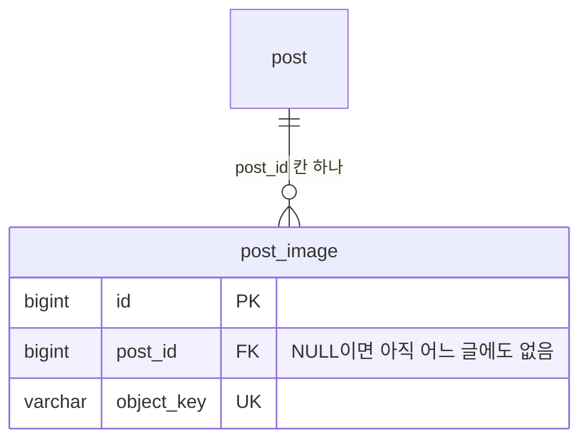
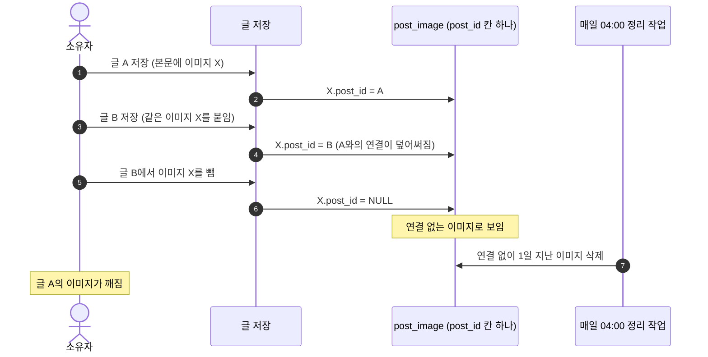
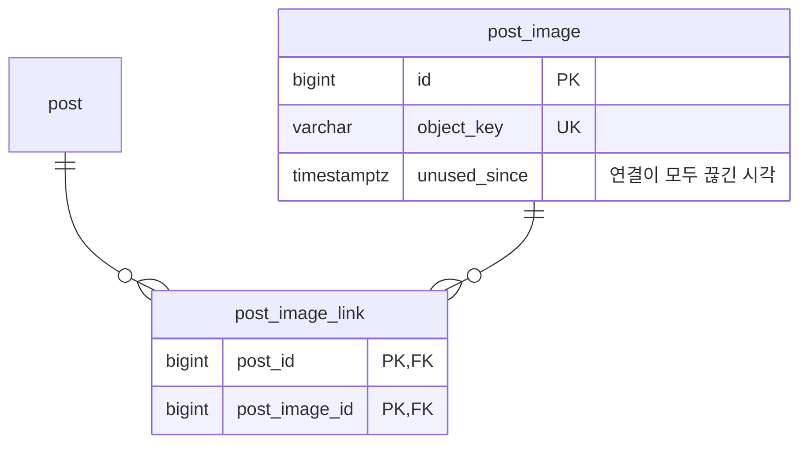
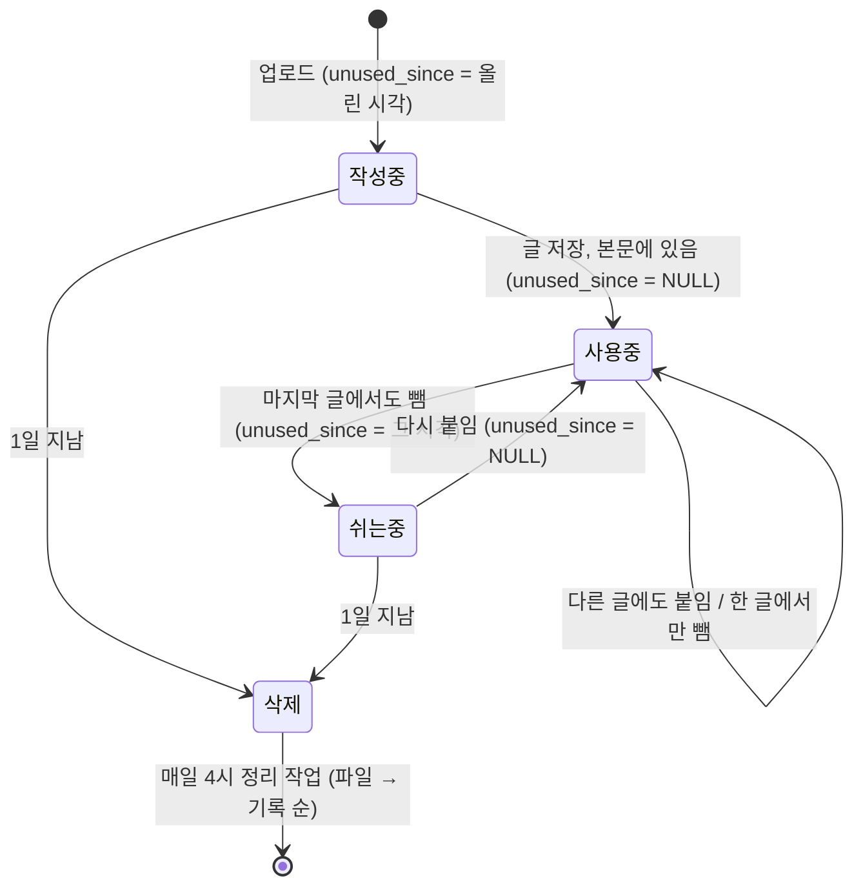

# 04. 한 이미지를 여러 글이 함께 쓰면

리팩토링 중에 이미지 기록이 사라질 수 있는 문제를 찾아 보고했고, 이런 답이 왔습니다.

> 한 이미지를 여러 글이 함께 쓸 수도 있긴 하겠다

## 답부터

함께 쓸 수 있게 바꿨습니다. 이미지 기록에 붙어 있던 "글 번호 칸 하나"를 없애고, 글과 이미지를 잇는 **연결 테이블**을 따로 만들었습니다(다대다 관계).

그리고 이미지를 언제 지울지의 기준을 "기록이 마지막으로 바뀐 시각"에서 **"연결이 모두 끊긴 시각"**으로 바꿨습니다.

---

## 원래는 이렇게 생겼습니다

이미지는 글을 저장하기 전에 먼저 올라갑니다. 편집기에 붙여 넣는 순간 업로드되기 때문입니다. 그래서 처음에는 어느 글에도 속하지 않고, 글을 저장할 때 본문에 쓰인 이미지를 그 글과 연결했습니다.



`post_image`에 `post_id` 칸이 하나 있었습니다. 이미지 하나가 글 하나에만 속할 수 있다는 뜻입니다.

## 그래서 이런 일이 생길 수 있었습니다

글 A에 쓴 이미지 주소를 복사해서 글 B에도 붙였다고 해 보겠습니다.



3번에서 A와의 연결이 조용히 사라집니다. 칸이 하나뿐이라 B를 적는 순간 A가 지워지기 때문입니다. 그 뒤로는 아무도 A가 X를 쓰고 있다는 것을 모릅니다.

글 A는 아무것도 하지 않았는데 이미지를 잃습니다. 데이터 손실입니다.

## 선택지는 세 가지였습니다

| 방법 | 어떻게 | 문제 |
| --- | --- | --- |
| 첫 글만 기억 | 이미 연결된 이미지는 다른 글에 붙여도 옮기지 않음 | A에서 빼는 순간 같은 문제가 B에서 생김 |
| 정리할 때 본문 검색 | 지우기 전에 모든 글 본문에 이 주소가 있는지 찾음 | 글이 늘수록 느려지고, 관계를 DB가 지켜 주지 못함 |
| 연결 테이블 | 글-이미지 쌍을 따로 저장 | 테이블이 하나 늘어남 |

세 번째를 골랐습니다. "글 하나가 이미지 여러 개를, 이미지 하나가 글 여러 개를" 가질 수 있는 관계를 다대다(many-to-many)라고 하고, 관계형 DB에서는 그 쌍을 담는 테이블을 따로 두는 것이 표준 방법입니다.

## 바꾼 모양



`post_image_link`의 한 줄이 "이 글이 이 이미지를 쓴다"는 뜻입니다. 같은 이미지를 두 글이 쓰면 두 줄이 생깁니다. 두 칸을 합쳐 기본 키로 삼아서 같은 쌍이 두 번 들어가지 않습니다.

이제 위 장면이 이렇게 바뀝니다.

| 단계 | `post_image_link` | X는 정리 대상인가 |
| --- | --- | --- |
| 글 A 저장 | (A, X) | 아니요 |
| 글 B 저장 | (A, X), (B, X) | 아니요 |
| 글 B에서 X를 뺌 | (A, X) | 아니요, A가 아직 씀 |
| 글 A에서도 X를 뺌 | 없음 | 이때부터 1일 뒤 |

## 언제부터 셀지도 바꿨습니다

연결이 없는 이미지를 바로 지우지는 않습니다. 글을 쓰다가 잠깐 뺐다 다시 넣을 수도 있으니 하루를 기다립니다.

예전에는 그 하루를 기록의 `updatedAt`(마지막으로 바뀐 시각)부터 셌습니다. `post_id`를 비우면 기록이 바뀌니 그 시각이 곧 끊긴 시각이었습니다.

연결 테이블로 바꾸면 이게 깨집니다. 연결을 끊는 일은 `post_image_link`에서 한 줄을 지우는 것이라 `post_image`의 `updatedAt`은 바뀌지 않습니다. 1년 전에 올린 이미지를 오늘 빼면, `updatedAt`은 1년 전이라 오늘 밤 바로 지워집니다.

그래서 뜻이 분명한 칸을 따로 만들었습니다.



`unused_since`가 비어 있으면 어떤 글이 쓰고 있는 것이고, 시각이 들어 있으면 그때부터 아무 글도 쓰지 않는 것입니다. 정리 작업은 이 시각이 1일 지난 것만 지웁니다.

`backend/src/main/java/com/zoolog/image/PostImage.java`의 두 메서드가 이 규칙의 전부입니다.

```java
public void linkTo(Post post) {
    posts.add(post);
    unusedSince = null;
}

public void unlinkFrom(Post post, Instant now) {
    posts.remove(post);
    if (posts.isEmpty() && unusedSince == null) {
        unusedSince = now;
    }
}
```

## 이미 있던 데이터도 옮겼습니다

스키마를 바꾸는 Flyway 마이그레이션 `V6__post_image_link.sql`에서 세 가지를 했습니다.

| 순서 | 한 일 |
| --- | --- |
| 1 | 기존 `post_id` 연결을 `post_image_link`로 옮김 |
| 2 | 모든 글 본문을 정규식으로 다시 읽어, 그동안 덮어써져 끊긴 연결을 복구 |
| 3 | 연결이 하나도 없는 이미지에 `unused_since` 채우고 `post_id` 칸 삭제 |

2번이 중요합니다. 버그가 있던 동안 이미 연결이 옮겨 간 이미지가 있을 수 있습니다. 칸만 바꾸면 그 이미지는 여전히 "연결 없음"으로 남아 지워집니다. 본문이 진짜 기준이니 본문에서 다시 읽어 복구했습니다.

마이그레이션 SQL은 실제로 돌리기 전에 개발 DB의 롤백 트랜잭션 안에서 따로 시험했습니다. 같은 이미지를 두 번 쓴 본문에서 연결이 한 줄만 생기는지 확인했습니다.

## 직접 확인해 보시기 바랍니다

두 글이 함께 쓰다가 한 글에서 빼도 연결이 남는지 확인하는 테스트입니다.

```bash
cd backend
./gradlew test --tests 'com.zoolog.image.ImageApiTest'
```

개발 DB에서 연결 상태를 직접 볼 수도 있습니다.

```bash
PGPASSWORD="$POSTGRES_PASSWORD" psql -h db -U "$POSTGRES_USER" -d "$POSTGRES_DB" \
  -c "select i.object_key, i.unused_since, count(l.post_id) as posts
      from post_image i left join post_image_link l on l.post_image_id = i.id
      group by i.id order by i.id"
```

`posts`가 0인 줄만 `unused_since`가 채워져 있어야 합니다. 편집기에서 한 이미지를 두 글에 붙여 저장한 뒤 다시 보면 `posts`가 2가 됩니다.

## 출처

- [Many-to-many 연관 관계 (Hibernate 사용자 가이드)](https://docs.hibernate.org/orm/7.0/userguide/html_single/#associations-many-to-many)
- [외래 키 제약 (PostgreSQL 문서)](https://www.postgresql.org/docs/current/ddl-constraints.html#DDL-CONSTRAINTS-FK)
- [Flyway 마이그레이션 개념](https://documentation.red-gate.com/fd/migrations-271585107.html)

## 관련

- 결정 기록: [decisions.md #18](../portfolio/decisions.md)
- 이 변경이 트랜잭션 flush 시점에도 영향을 준 이야기: [02](02-transaction-boundary.md)
