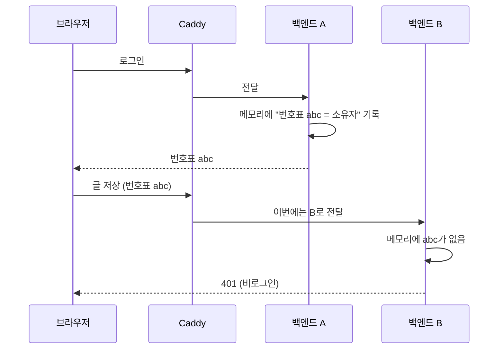
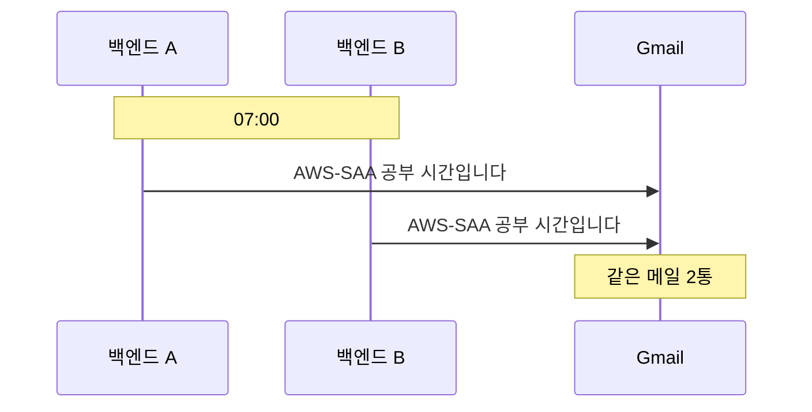
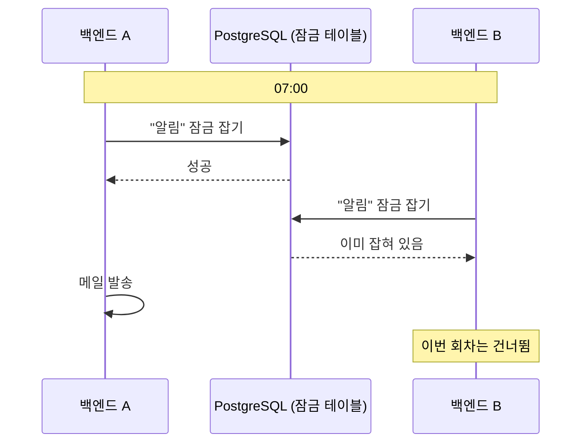
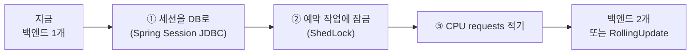

# 05. 백엔드를 2개로 늘리면 무엇이 깨지나

쿠버네티스 수업 글("서버를 나누려면 인프라만이 아니라 앱도 바뀐다")을 Zoolog에 대 보는 검토를 했고, 그 끝에 "나중에 할 것"으로 세 가지를 꼽았습니다. 그러자 이런 질문이 나왔습니다.

> 아 내 말은 나중에 할 것이 뭔 말인지 모르겠어

## 답부터

지금 백엔드(Spring Boot)는 서버에 **딱 1개**만 떠 있습니다. 코드도 은연중에 "나는 혼자다"를 전제로 짜여 있습니다.

나중에 백엔드를 **2개 이상** 띄우는 순간 그 전제가 깨지면서 세 가지가 문제가 됩니다.

| 무엇이 | 어떻게 깨지나 | 고치는 방향 |
| --- | --- | --- |
| 로그인 | 로그인이 풀린 것처럼 보입니다 | 로그인 정보를 백엔드 밖(DB 등)에 둠 |
| 예약 작업 | 알림 메일이 2통씩 옵니다 | 한쪽만 실행하게 잠금 장치를 붙임 |
| CPU | 여럿이 다툴 때 나누는 기준이 없습니다 | CPU 몫(requests)을 적어 둠 |

**지금은 할 필요가 없습니다.** 백엔드를 늘리기 전에만 하면 됩니다. 무중단 배포를 보류했으니([01](01-zero-downtime.md)) 당분간 1개 그대로입니다.

---

## 언제 2개가 되나

일부러 늘리지 않아도 2개가 되는 순간이 있습니다.

| 상황 | 왜 2개가 되나 |
| --- | --- |
| 무중단 배포(RollingUpdate)로 바꿀 때 | 새 파드를 먼저 띄우고 옛 파드를 내리므로 배포 중 잠깐 2개 |
| 방문자가 많아져 `replicas: 2`로 늘릴 때 | 계속 2개 |
| 서버를 여러 대로 나눌 때 | 서버마다 1개씩 |

첫 번째가 특히 놓치기 쉽습니다. 배포할 때마다 몇십 초씩 2개가 겹칩니다.

## ① 로그인이 풀린 것처럼 보입니다

로그인하면 서버는 "이 사람은 소유자"라는 기록(세션)을 만들고, 브라우저에는 번호표(`JSESSIONID` 쿠키)만 줍니다. 그 기록이 지금은 **백엔드의 메모리 안**에 있습니다.



요청이 어느 백엔드로 갈지는 Caddy와 쿠버네티스 Service가 정합니다. 사람이 고를 수 없습니다. 그래서 로그인은 A에서 했는데 다음 요청이 B로 가면, B는 그 사람을 모릅니다.

### 고치는 방향

번호표의 기록을 **모든 백엔드가 함께 보는 곳**에 둡니다.

| 방법 | 어떻게 | Zoolog에 맞나 |
| --- | --- | --- |
| Spring Session JDBC | 세션을 PostgreSQL 테이블에 저장 | 맞습니다. DB가 이미 있어서 새로 띄울 것이 없음 |
| Spring Session + Redis·Valkey | 세션을 Redis에 저장 | 빠르지만 Redis를 하나 더 띄워야 함 (2GB 서버에 부담) |
| 토큰 방식(JWT)으로 바꾸기 | 서버가 기록하지 않고 브라우저가 증명서를 들고 다님 | 로그인 구조를 다시 짜야 함 (서버 세션 방식은 이미 결정한 사항) |

덤으로, 세션을 DB에 두면 **배포 후 재로그인도 없어집니다.** 새 파드도 같은 테이블을 읽기 때문입니다.

## ② 메일이 2통씩 옵니다

백엔드는 시간이 되면 스스로 하는 일이 있습니다. 코드에서 찾은 것입니다.

| 작업 | 시각 | 위치 |
| --- | --- | --- |
| 공부 알림 메일 | 07:00, 18:00 | `notification/ReminderScheduler.java` |
| 아침 기사 메일 | 06:00, 못 보냈으면 매시 정각과 서버 시작 시 | `news/NewsDigestScheduler.java` |
| 연결 없는 이미지 정리 | 04:00 | `image/ImageCleanupScheduler.java` |

이 작업들은 **백엔드마다 각자** 시계를 보고 실행됩니다. 2개면 두 번 실행됩니다.



작업마다 결과가 다릅니다.

| 작업 | 2번 실행되면 |
| --- | --- |
| 공부 알림 | 메일 2통 (막는 장치 없음) |
| 아침 기사 | 보낸 기록(`news_digest_log`)을 보지만, 둘이 거의 동시에 "아직 안 보냈네"를 보면 2통 갈 수 있음 |
| 이미지 정리 | 같은 이미지를 둘이 지우려 함. 결과는 같지만 한쪽에 오류 로그가 남을 수 있음 |

아침 기사 쪽에 있는 `synchronized`는 "한 번에 하나만"을 지켜 주는 장치인데, **한 백엔드 안에서만** 통합니다. 다른 백엔드는 다른 프로그램이라 서로의 `synchronized`를 모릅니다.

### 고치는 방향

여러 백엔드가 함께 보는 곳(역시 DB)에 **잠금 표시**를 두고, 먼저 잡은 쪽만 실행합니다. 이 일을 해 주는 라이브러리가 ShedLock입니다.



ShedLock 문서의 첫 문장입니다.

> ShedLock makes sure that your scheduled tasks are executed at most once at the same time.
> (ShedLock은 예약 작업이 같은 시각에 최대 한 번만 실행되도록 보장합니다.)

같은 문서에 "ShedLock is not a distributed scheduler"(분산 스케줄러가 아니다)라는 절도 있습니다. 일정을 나눠 주는 도구가 아니라, 같은 작업이 두 군데서 동시에 돌지 않게 막는 데까지만 합니다.

## ③ CPU를 나눠 쓰는 기준이 없습니다

`deploy/k8s/`의 매니페스트에는 컨테이너마다 메모리 몫이 적혀 있습니다.

```yaml
resources:
  requests:
    memory: 384Mi
  limits:
    memory: 640Mi
```

그런데 CPU는 어디에도 없습니다.

| 값 | 뜻 | 지금 |
| --- | --- | --- |
| `requests` | "최소 이만큼은 보장해 주세요". 스케줄러가 자리를 잡을 때 씀 | 메모리만 있음 |
| `limits` | "이 이상은 쓰면 안 됨" | 메모리만 있음 |

지금은 백엔드가 하나라 CPU를 다툴 상대가 없습니다. 하지만 같은 서버에 백엔드가 여럿 뜨거나 다른 서비스가 붙으면, CPU를 누가 얼마나 가질지 기준이 필요합니다. 특히 Lightsail은 평소에는 CPU를 조금만 쓰다가 잠깐씩 몰아 쓰는 **버스트형**이라, 몫을 정해 두지 않으면 바쁜 순간에 한쪽이 다른 쪽을 밀어낼 수 있습니다.

## 순서

늘리기로 했다면 이 순서로 하면 됩니다.



①과 ②는 앱 코드와 설정을, ③은 매니페스트를 바꿉니다. 셋 다 끝나기 전에 늘리면 위에서 본 증상이 바로 나타납니다.

## 이미 2개가 되어도 괜찮은 것

모든 것이 깨지는 것은 아닙니다. 이미 "혼자가 아닐 수 있다"를 전제로 짠 부분도 있습니다.

| 무엇 | 왜 괜찮나 |
| --- | --- |
| 업로드한 이미지 | 백엔드 디스크가 아니라 SeaweedFS(오브젝트 저장소)에 있어서 어느 백엔드든 같은 파일을 읽음 |
| 글, 주제 | 전부 PostgreSQL에 있음 |
| 오래 걸리는 작업 | 기사 메일은 사용자 요청 안이 아니라 예약 작업에서 돌아서, 요청이 오래 붙잡히지 않음 |

## 직접 확인해 보시기 바랍니다

시간이 되면 스스로 도는 작업을 코드에서 찾습니다.

```bash
cd backend
grep -rn "@Scheduled\|addCronTask\|ApplicationReadyEvent" src/main/java
```

여기 나오는 것이 전부 "2개가 되면 2번 도는" 후보입니다.

운영 서버의 CPU 몫이 비어 있는 것도 확인할 수 있습니다.

```bash
kubectl -n zoolog get deploy backend -o jsonpath='{.spec.template.spec.containers[0].resources}{"\n"}'
```

`memory`만 나오고 `cpu`가 없습니다.

로그인 기록이 백엔드 메모리에 있다는 것은 배포로 확인됩니다. 로그인해 둔 상태에서 배포가 끝나면 다시 로그인해야 합니다. 새 백엔드의 메모리는 비어 있기 때문입니다.

## 출처

- [Spring Session](https://docs.spring.io/spring-session/reference/)
- [ShedLock](https://github.com/lukas-krecan/ShedLock)
- [Task Execution and Scheduling (Spring 문서)](https://docs.spring.io/spring-framework/reference/integration/scheduling.html)
- [Resource Management for Pods and Containers (Kubernetes 문서)](https://kubernetes.io/docs/concepts/configuration/manage-resources-containers/)

## 관련

- 무중단 배포를 보류한 이유: [01](01-zero-downtime.md)
- 같은 기사 메일이 하루 한 번만 가도록 한 장치: [decisions.md #19](../portfolio/decisions.md)
