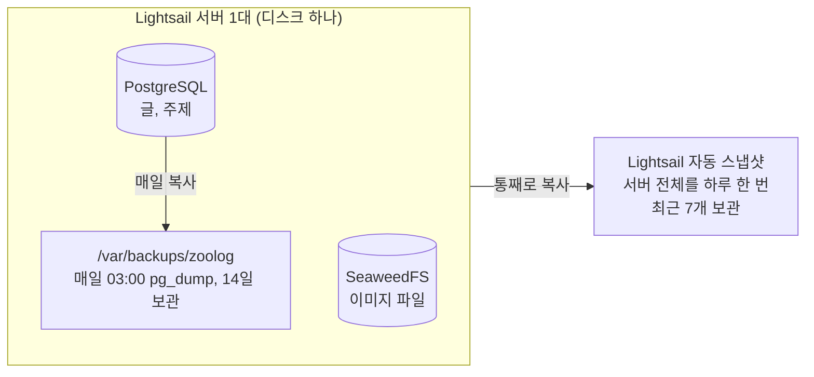

# 06. 백업이 같은 서버 안에만 있다는 게 무슨 말이야

쿠버네티스 수업 글을 Zoolog에 대 보는 검토에서 "백업이 서버 디스크 안에만 있다"는 빈틈을 이야기했습니다. 그러자 이런 답이 왔습니다.

> 비용이 조금 생기는 결정은 안 할 거야

> 무슨 말인지 정확하게 잘 모르겠네

## 답부터

백업은 두 가지가 있고, **막아 주는 사고가 서로 다릅니다.**

| 사고 | 막아 주는 것 | 어디에 있나 |
| --- | --- | --- |
| 실수로 글을 지움 | 매일 03:00 DB 백업 (`pg_dump`) | 같은 서버 디스크 |
| 서버나 디스크가 통째로 고장 | Lightsail 자동 스냅샷 | 서버 밖 (AWS 쪽) |

그래서 지금도 무방비는 아닙니다. 다만 스냅샷이 하루 한 번이라, 서버가 통째로 망가지면 **마지막 스냅샷 이후 쓴 글(최대 하루치)**을 잃을 수 있습니다. 개인 블로그에서는 감수할 만해서, 돈이 드는 방법은 쓰지 않기로 했습니다.

---

## 노트북으로 비유하면

노트북에 문서를 저장하고, 백업 복사본도 **같은 노트북의 다른 폴더**에 둔 상태와 같습니다.

- 문서를 실수로 지웠을 때: 백업 폴더에서 되살릴 수 있습니다
- 노트북이 고장 났을 때: 백업 폴더도 같이 사라집니다

`pg_dump` 백업이 앞의 경우를, 스냅샷이 뒤의 경우를 맡습니다.

## 그림으로 보면



몇 가지가 그림에서 보입니다.

- `pg_dump`는 **DB만** 복사합니다. 이미지 파일(SeaweedFS)은 들어 있지 않습니다
- `pg_dump` 결과는 **같은 디스크**에 있습니다
- 스냅샷은 서버 전체(DB, 이미지, 백업 폴더까지)를 서버 밖에 둡니다

## 사고별로 무엇이 남나

| 사고 | 글 | 이미지 | 어디서 되살리나 |
| --- | --- | --- | --- |
| 글 하나를 실수로 지움 | 남음 | 남음 (하루 안에 다시 붙이면) | 전날 `pg_dump` |
| DB가 이상해짐 | 전날 03:00까지 | 그대로 | `pg_dump` |
| 서버·디스크 고장 | 마지막 스냅샷까지 | 마지막 스냅샷까지 | 스냅샷으로 새 서버 |
| Lightsail 서버(인스턴스)를 실수로 삭제 | **사라질 수 있음** | **사라질 수 있음** | 아래 참고 |

마지막 줄이 중요합니다. Lightsail 문서의 서술입니다.

> The latest seven daily automatic snapshots are stored before the oldest one is replaced with the newest one. Additionally, all automatic snapshots associated with a resource are deleted when you delete the source resource.
> (최근 7개의 일일 자동 스냅샷이 보관되고, 가장 오래된 것부터 새것으로 바뀝니다. 또한 원본 리소스를 삭제하면 그 리소스의 자동 스냅샷도 모두 삭제됩니다.)

**자동 스냅샷은 서버를 지우면 함께 지워집니다.** 같은 문서는 이것을 막으려면 자동 스냅샷을 수동 스냅샷으로 복사해 두라고 안내합니다. 수동 스냅샷은 서버를 지워도 계정에 남습니다. 서버를 지우거나 다시 만들 일이 생기면, 그 전에 수동 스냅샷부터 만들어 두시면 됩니다.

## 돈이 들지 않는 방법

불안할 때가 생기면 서버의 백업 파일을 노트북으로 가끔 받아 두면 됩니다. 서버 밖에 복사본이 하나 더 생깁니다. Tailscale로 이미 접속하고 있으니 노트북에서 한 줄이면 됩니다.

```bash
scp -r ubuntu@<서버 Tailscale 이름>:/var/backups/zoolog ./zoolog-backup
```

꼭 하지 않아도 되고, 글을 많이 쓴 날에만 해도 충분합니다. 이 파일에는 글 내용이 들어 있으니 공개 저장소(GitHub)에는 올리지 않습니다.

## 직접 확인해 보시기 바랍니다

서버에서 DB 백업이 매일 쌓이고 있는지 봅니다. 파일 이름에 날짜와 시각이 들어 있습니다.

```bash
ls -lh /var/backups/zoolog
```

백업 작업이 언제 마지막으로 돌았는지는 이렇게 봅니다.

```bash
kubectl -n zoolog get cronjob postgres-backup
kubectl -n zoolog get jobs
```

자동 스냅샷은 Lightsail 콘솔에서 인스턴스를 고른 뒤 **Snapshots** 탭에서 봅니다. 날짜별로 최대 7개가 보이면 정상입니다.

## 출처

- [Lightsail 자동 스냅샷 설정과 보관 (AWS 문서)](https://docs.aws.amazon.com/lightsail/latest/userguide/amazon-lightsail-configuring-automatic-snapshots.html)
- [pg_dump (PostgreSQL 문서)](https://www.postgresql.org/docs/current/app-pgdump.html)
- [CronJob (Kubernetes 문서)](https://kubernetes.io/docs/concepts/workloads/controllers/cron-jobs/)

## 관련

- 이 이야기가 나온 검토: 서버 1대 k3s의 한계와 확장 준비 [05](05-scale-out-prerequisites.md)
- 백업 작업 설정: `deploy/k8s/backup.yaml`
